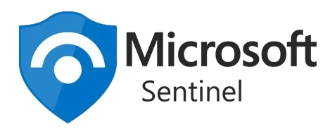
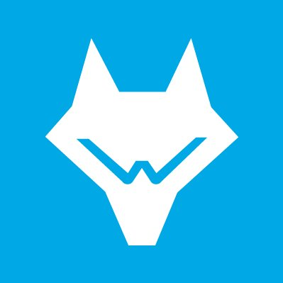
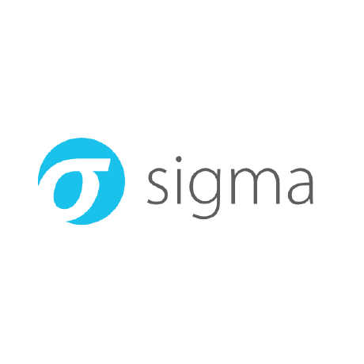
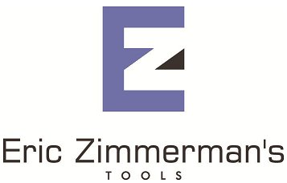

<h1 align="center">Yves-Roland OHIN</h1>

  

Analyste SOC /Detection Engineer en **Master 1 Cybersécurité à l'ESGI Paris**, certifié **Blue Team Level 1 (BTL1)** et actuellement en préparation des certifications **HTB CDSA** et **Microsoft SC-200**, je développe une expertise pratique en **Security Operations, Threat Hunting, Incident Response et Detection Engineering**.

Mon approche de la cyberdéfense repose sur une conviction : **une alerte ne constitue pas une investigation tant que les événements n'ont pas été corrélés, contextualisés et replacés dans une chaîne d'attaque cohérente.**

À travers des laboratoires avancés, des CTF Blue Team et des scénarios d'investigation sur **Hack The Box** et **TryHackMe**, je travaille sur l'ensemble du cycle d'analyse et de réponse :

- **SOC & SIEM :** qualification et triage d'alertes, analyse de télémétrie Windows/Sysmon/EDR, corrélation multi-sources, requêtes SPL/KQL et reconstruction de timelines sous Splunk et Microsoft Sentinel.
- **Threat Hunting :** recherche d'IOC et d'indices comportementaux, analyse des TTP adverses, exploitation des arbres de processus, des relations parent-enfant et des événements d'authentification.
- **Windows & Active Directory :** investigation des mécanismes d'exécution, de persistance, d'élévation de privilèges et de mouvement latéral, avec analyse des événements de sécurité Windows.
- **Network Forensics :** analyse de captures PCAP, investigation DNS/HTTP/TLS, identification de communications suspectes et recherche d'indicateurs de Command & Control avec Wireshark.
- **Digital Forensics & Incident Response :** collecte et analyse d'artefacts, reconstruction de chaînes d'attaque, corrélation temporelle, identification du périmètre de compromission et documentation des résultats.
- **Detection Engineering :** mapping MITRE ATT&CK, conception de logiques de détection comportementale, exploitation des sources de télémétrie et amélioration de la couverture de détection.

Je m'intéresse particulièrement aux mécanismes internes de Windows, aux **ETW Providers**, à la visibilité offerte par Sysmon et aux limites de la télémétrie face aux techniques d'évasion.

**Mon objectif : passer de l'analyse d'alertes à la compréhension des comportements adverses, puis transformer les résultats d'investigation en détections exploitables, contextualisées et reproductibles.**

### Certifications

- **BTL1 — Blue Team Level 1 :** obtenue
- **HTB CDSA — Certified Defensive Security Analyst :** en préparation
- **Microsoft SC-200 — Security Operations Analyst :** en préparation

### Opportunités

Je recherche une **alternance ou un stage alterné de six mois** en SOC, CSIRT, DFIR, Threat Hunting ou Detection Engineering, selon un rythme de **trois semaines en entreprise et une semaine à l'école**.

Ce portfolio rassemble mes investigations, analyses techniques, laboratoires de cyberdéfense et travaux pratiques en détection et réponse aux incidents.

Mastère Expert Architecture Systèmes, Réseaux &amp; Sécurité — <b>ESGI Paris</b> (2026–2028) 
Orienté défense : détection, réponse à incident, threat hunting &amp; CTI 
En recherche d'une <b>alternance dès septembre 2026</b>

  

---

<h3 align="center">Certifications</h3>

| Certification | Organisme | Statut |
|:---|:---|:---:|
| **Blue Team Level 1 (BTL1)** | Security Blue Team | Obtenue |
| **Google Cybersecurity Certificate** | Google | Obtenue |
| **CDSA** — Certified Defensive Security Analyst | Hack The Box | En cours |
| **SC-200** — Security Operations Analyst | Microsoft | En cours |

---

<h3 align="center">Stack &amp; Outils</h3>

<b>SIEM &amp; Détection</b>

  &nbsp;&nbsp;&nbsp;
  &nbsp;&nbsp;&nbsp;
  &nbsp;&nbsp;&nbsp;
  &nbsp;&nbsp;&nbsp;
  &nbsp;&nbsp;&nbsp;
  

<b>Réseau &amp; Forensique</b>

  &nbsp;&nbsp;&nbsp;
  &nbsp;&nbsp;&nbsp;
  &nbsp;&nbsp;&nbsp;
  &nbsp;&nbsp;&nbsp;
  
  

<b>Systèmes &amp; Scripting</b>

  

---

<h3 align="center">Projets SOC &amp; Blue Team</h3>

**[Investigation Splunk — Ransomware Cerber (BOTSv1)](https://github.com/rolandohin/Cerber-Ransomware-Investigation-with-Splunk)**
49 608 événements analysés · binaire Windows falsifié détecté · 16 384 IP C2 identifiées · corrélation Sysmon / Fortigate / Suricata.

**[Réponse à incident APT « Poisoned Aid » — Forensics](https://github.com/rolandohin/apt-dfir)**
Reconstruction d'une timeline de 4 jours : timestomping (MFT), infostealer Python multi-stage, persistance via Scheduled Task, analyse PCAP TLS/C2 — mapping MITRE ATT&CK complet.

**[Honeypot multi-services (Python)](https://github.com/rolandohin/honeypot-multi-services)**
Honeypot SSH / HTTP / FTP / SMTP capturant credentials et commandes des attaquants · dashboard Flask temps réel · rapports PDF automatisés.

**[Forensique mémoire — Volatility](https://github.com/rolandohin/forensique)**
Analyse de captures RAM compromises : processus malveillants, connexion C2 via WINWORD.EXE, extraction et hash de l'exécutable.

---

<h3 align="center">GitHub Stats</h3>

  
  

  

---

  

